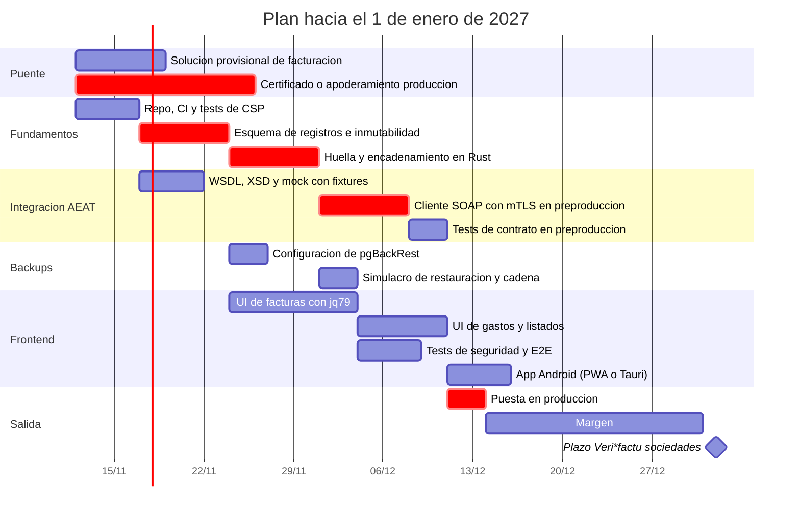

# ROADMAP - Gestión de gastos y facturas con Veri*factu

Fecha: 2026-11-11

> Este documento resume las decisiones tomadas hasta ahora, lo que está propuesto pero sin cerrar, y lo que sigue abierto. No es asesoría legal ni fiscal: las partes normativas deben validarse con un asesor.

## 1. Objetivo

Aplicación para llevar las cuentas de una SL (por ahora con un solo miembro) y cumplir la normativa española vigente, incluida la integración con Veri*factu.

- Facturas emitidas con registro de facturación verificable.
- Gastos y facturas recibidas.
- Libros de IVA exportables.
- Contabilidad y modelos fiscales en una fase posterior.

Mantenimiento: lo asume el propio autor. Se busca control total de la pila.

## 2. Leyenda de estado

- **Decidido**: elegido por el autor.
- **Propuesto**: planteado en la conversación y sin objeciones, pero no cerrado.
- **Abierto**: falta decidir.

## 3. Decisiones

| Área | Decisión | Estado |
|---|---|---|
| Clientes | Web mobile first + app Android | Decidido |
| Backend | Rust | Decidido |
| Base de datos | Postgres | Decidido (implícito en pgBackRest) |
| Backups y réplica periódica | pgBackRest (frente a WAL-G) | Decidido |
| Backup en GitHub (diffs del dump) | Descartado | Decidido |
| Frontend | jq79 (framework propio) | Decidido, con comprobación de CSP pendiente |
| Mantenimiento | Lo asume el autor | Decidido |
| Framework web y acceso a datos | Axum + Tokio + SQLx | Propuesto |
| App Android | PWA o contenedor, o Tauri v2 | Abierto |

Motivos de jq79: mantener el control de todo, entender mejor CSP y XSS en general, y contrastar el framework con requisitos estrictos para mejorarlo.

## 4. Requisitos normativos clave (Veri*factu)

- **Plazos:** las sociedades deben usar un sistema adaptado antes del 1 de enero de 2027. Autónomos y resto de obligados, antes del 1 de julio de 2027. Los fabricantes de software, desde el 29 de julio de 2025.
- **Normas:** Orden HAC/1177/2024, RD 1007/2023 y RDL 15/2025.
- **Registros:** alta, anulación y subsanación. Nunca se editan ni se borran. Las correcciones son registros nuevos.
- **Huella:** SHA-256 encadenada con el registro anterior. Los campos exactos, el orden y el formato los fija la especificación técnica de la AEAT.
- **Registro de eventos:** también encadenado.
- **QR y leyenda** en las facturas.
- **Conservación:** libros y justificantes durante los plazos legales.
- **Declaración responsable** del sistema informático: validar con el asesor si aplica a un software de uso propio.

## 5. Arquitectura y diseño propuestos

### Registros inalterables
- Tabla de registros solo de inserción.
- Rol de la aplicación con solo `INSERT` y `SELECT`.
- Trigger que bloquea `UPDATE`, `DELETE` y `TRUNCATE`.
- Inserción dentro de una transacción que bloquea la cabeza de la cadena.
- `UNIQUE` sobre la huella anterior y sobre `(nif, serie, numero)`.
- Guardar el XML enviado y la respuesta de la AEAT.
- Job periódico que recalcula la cadena y avisa de incoherencias.
- Función de exportación de registros y eventos.

### Backend
- Axum + Tokio + SQLx con consultas verificadas en compilación.
- Importes con `NUMERIC` y `rust_decimal`, nunca `f64`.
- `sha2` para la huella, `quick-xml` para el XML, `reqwest` con rustls e identidad de cliente para mTLS.

### Frontend y seguridad
- jq79 como framework de interfaz, detrás de un cliente de API tipado para poder sustituirlo si hiciera falta.
- CSP estricto, sin `unsafe-eval` ni `unsafe-inline`.
- Trusted Types para inserciones de HTML.
- Sanitización en un único punto.
- Cookies `HttpOnly`, `Secure`, `SameSite` y protección CSRF.
- Cabeceras de seguridad en el servidor (por ejemplo con `tower-http`).

### Lo crítico, en el servidor
Validación, huella, cadena e inmutabilidad viven en el backend. Un fallo de interfaz nunca debe poder corromper un registro.

## 6. Backups

- pgBackRest con dos repositorios: uno local y otro S3-compatible en otro proveedor, ambos cifrados.
- Completo semanal y diferencial diario.
- Retención corta, fija y documentada.
- Claves de cifrado guardadas fuera del servidor.
- Restauración a un instante concreto (PITR) con archivado continuo de WAL.
- Simulacro de restauración periódico: restaurar en un entorno aparte, recalcular la cadena de hashes y comprobar que los últimos registros enviados a la AEAT están todos.
- RGPD: los datos personales opcionales van en tablas aparte. Las facturas no se pueden borrar durante el plazo de conservación legal.
- Nota: si se usa un operador de Kubernetes, pgBackRest es nativo en el de Crunchy (PGO). CloudNativePG usa Barman.

## 7. Entornos y pruebas

- **Mock de la AEAT** generado desde los WSDL y XSD oficiales, con respuestas reales de preproducción como fixtures y esquemas fijados por versión.
- **Preproducción de la AEAT:** tests de contrato programados (por ejemplo, nocturnos), no en cada commit.
- **Qué prueba el mock:** XML contra XSD, huella, cadena, reintentos, colas e inyección de fallos.
- **Qué no prueba:** validación de NIF contra el censo, mTLS, límites reales del servicio.
- **Certificado en pruebas:** el certificado personal sirve si el obligado a la emisión del XML eres tú (tu NIF y tu nombre tal como constan en el censo). Con el NIF de la SL, se espera rechazo salvo representación.
- **Certificado en producción:** el autor no es miembro de la SL. Dos caminos: la SL usa el certificado de su representante, o la SL apodera al autor para el envío de registros de facturación (apoderamiento inscrito en el registro de apoderamientos).
- El mock debe ser inalcanzable desde la configuración de producción.

## 8. Despliegue (a decidir)

Criterios: datos en la UE, backups fuera del servidor, restauración en horas, simplicidad operativa.

1. Servidor propio actual: bueno para mock, CI y preproducción. Un solo nodo es punto único de fallo para datos fiscales.
2. VPS o servidor pequeño en la UE con Docker Compose o systemd, Postgres y pgBackRest a S3 de otro proveedor.
3. Postgres gestionado en un proveedor europeo y binario aparte.
4. Kubernetes con operador de Postgres (PGO si se mantiene pgBackRest).

Además: certificado de la AEAT cifrado y fuera del repositorio, monitorización de envíos a la AEAT, de la verificación de la cadena y de los backups, y contrato de encargado de tratamiento si la SL es de otra persona.

## 9. Plan (estimación)

## 10. Preguntas abiertas

- Modalidad: Veri*factu (envío automático) o No Veri*factu (conservación y entrega bajo requerimiento, con requisitos de conservación más exigentes).
- Certificado en producción: el de la SL o apoderamiento al autor.
- Dónde desplegar.
- App Android: PWA o contenedor, o Tauri v2. Depende de si hace falta algo nativo (cámara para tickets, biometría, notificaciones push).
- Alcance de la contabilidad: PGC, libro diario y mayor, legalización en el Registro Mercantil, depósito de cuentas, modelos fiscales. Se propone empezar por facturas emitidas, gastos y libros de IVA, y exportar a la gestoría lo demás.
- Si aplica la declaración responsable de productor a un software de uso propio.
- Compatibilidad de jq79 con CSP estricto (si evalúa expresiones en cadena, habrá que rediseñar las directivas).

## 11. Riesgos

- **Plazo:** menos de dos meses hasta el 1 de enero de 2027. Hace falta una solución provisional si la SL factura.
- **Punto único de fallo:** una sola persona mantiene backend, frontend, despliegue y relación con la AEAT.
- **Deriva del mock:** los esquemas y códigos de error de la AEAT cambian. Contrastar con preproducción.
- **Restauración:** una restauración anterior a registros ya enviados a la AEAT exige reconciliar con lo enviado.
- **Frontend propio:** el coste de construir componentes que jq79 aún no cubra compite con el de la lógica fiscal.

## 12. Referencias

- Orden HAC/1177/2024, de 17 de octubre.
- RD 1007/2023, de 5 de diciembre.
- RDL 15/2025.
- Sede electrónica de la AEAT, sección de sistemas informáticos de facturación y Veri*factu.
- Documentación técnica de la AEAT: descripción de servicios web, WSDL y XSD.
