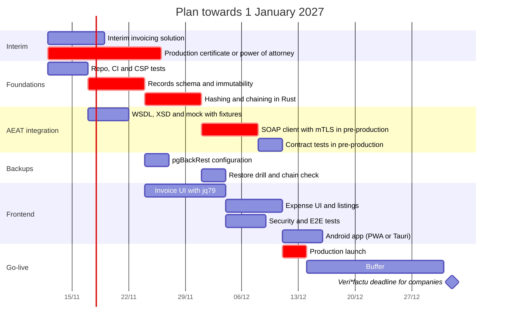

# Roadmap: expense and invoice management with Veri*factu

Date: 2026-11-11

> This document summarizes the decisions made so far, what has been proposed but not settled, and what is still open. It is not legal or tax advice: the regulatory parts must be validated with an advisor.

Supporting documents:

- [Interface and entities](interface-and-entities.md): the screens agreed with the author and the database entities they need.

## 1. Goal

An application to keep the books of an SL (Spanish limited company, currently with a single member) and comply with current Spanish regulations, including Veri*factu integration.

- Issued invoices with verifiable invoicing records.
- Expenses and received invoices.
- Exportable VAT books.
- Accounting and tax forms in a later phase.

Maintenance: handled by the author. The goal is full control of the stack.

## 2. Status legend

- **Decided**: chosen by the author.
- **Proposed**: raised in the discussion with no objections, but not settled.
- **Open**: still to be decided.

## 3. Decisions

| Area | Decision | Status |
|---|---|---|
| Clients | Mobile-first web + Android app | Decided |
| Backend | Rust | Decided |
| Database | Postgres | Decided (implied by pgBackRest) |
| Backups and periodic replica | pgBackRest (over WAL-G) | Decided |
| Backup to GitHub (dump diffs) | Discarded | Decided |
| Frontend | jq79 (in-house framework) | Decided, CSP check pending |
| Maintenance | Handled by the author | Decided |
| Web framework and data access | Axum + Tokio + SQLx | Proposed |
| Android app | PWA or wrapper, or Tauri v2 | Open |

Reasons for jq79: keep control of everything, gain a better understanding of CSP and XSS in general, and test the framework against strict requirements in order to improve it.

## 4. Key regulatory requirements (Veri*factu)

- **Deadlines:** companies must use a compliant system before 1 January 2027. Sole traders and all other obligated parties, before 1 July 2027. Software producers, since 29 July 2025.
- **Regulations:** Orden HAC/1177/2024, RD 1007/2023 and RDL 15/2025.
- **Records:** registration, cancellation and correction. They are never edited or deleted. Corrections are new records.
- **Hash:** SHA-256 chained to the previous record. The exact fields, order and format are set by the AEAT technical specification.
- **Event log:** also chained.
- **QR code and legend** on invoices.
- **Retention:** books and supporting documents for the legal retention periods.
- **Statement of conformity** (*declaración responsable*) of the invoicing system: check with the advisor whether it applies to software for in-house use.

## 5. Proposed architecture and design

### Immutable records
- Insert-only records table.
- Application role with only `INSERT` and `SELECT`.
- Trigger that blocks `UPDATE`, `DELETE` and `TRUNCATE`.
- Insertion inside a transaction that locks the head of the chain.
- `UNIQUE` on the previous hash and on `(nif, series, number)`.
- Store the XML sent and the AEAT response.
- Periodic job that recomputes the chain and alerts on inconsistencies.
- Export function for records and events.

### Backend
- Axum + Tokio + SQLx with compile-time checked queries.
- Amounts as `NUMERIC` and `rust_decimal`, never `f64`.
- `sha2` for the hash, `quick-xml` for the XML, `reqwest` with rustls and a client identity for mTLS.

### Frontend and security
- jq79 as the UI framework, behind a typed API client so it can be replaced if needed.
- Strict CSP, without `unsafe-eval` or `unsafe-inline`.
- Trusted Types for HTML insertion.
- Sanitization at a single point.
- `HttpOnly`, `Secure` and `SameSite` cookies, plus CSRF protection.
- Security headers on the server (for example with `tower-http`).

### Critical logic lives on the server
Validation, hashing, chaining and immutability live in the backend. A UI bug must never be able to corrupt a record.

## 6. Backups

- pgBackRest with two repositories: one local and one S3-compatible at a different provider, both encrypted.
- Weekly full backup and daily differential.
- Short, fixed and documented retention.
- Encryption keys stored off the server.
- Point-in-time recovery (PITR) with continuous WAL archiving.
- Periodic restore drill: restore into a separate environment, recompute the hash chain and check that the latest records sent to the AEAT are all present.
- GDPR: optional personal data goes in separate tables. Invoices cannot be deleted during the legal retention period.
- Note: if a Kubernetes operator is used, pgBackRest is native in Crunchy's operator (PGO). CloudNativePG uses Barman.

## 7. Environments and testing

- **AEAT mock** generated from the official WSDL and XSD files, with real pre-production responses as fixtures and schemas pinned by version.
- **AEAT pre-production:** scheduled contract tests (for example, nightly), not on every commit.
- **What the mock tests:** XML against XSD, hash, chain, retries, queues and fault injection.
- **What it does not test:** NIF validation against the tax census, mTLS, real service limits.
- **Certificate for testing:** the personal certificate works if the obligated issuer in the XML is the author (the author's NIF and name exactly as registered in the census). With the SL's NIF, a rejection is expected unless there is representation.
- **Certificate for production:** the author is not a member of the SL. Two paths: the SL uses its representative's certificate, or the SL grants the author a power of attorney to submit invoicing records (registered in the AEAT power-of-attorney registry).
- The mock must be unreachable from the production configuration.

## 8. Deployment (to be decided)

Criteria: data in the EU, off-server backups, restore within hours, operational simplicity.

1. Current self-hosted server: good for the mock, CI and pre-production. A single node is a single point of failure for tax data.
2. Small VPS or server in the EU with Docker Compose or systemd, Postgres and pgBackRest to S3 at another provider.
3. Managed Postgres at a European provider and a separate binary.
4. Kubernetes with a Postgres operator (PGO if pgBackRest is kept).

Also: the AEAT certificate encrypted and kept outside the repository; monitoring of AEAT submissions, chain verification and backups; and a data processing agreement if the SL belongs to someone else.

## 9. Plan (estimate)

## 10. Open questions

- Mode: Veri*factu (automatic submission) or non-Veri*factu (retention and delivery upon request, with stricter retention requirements).
- Production certificate: the SL's own, or a power of attorney granted to the author.
- Where to deploy.
- Android app: PWA or wrapper, or Tauri v2. It depends on whether anything native is needed (camera for receipts, biometrics, push notifications).
- Accounting scope: PGC (Spanish general chart of accounts), journal and general ledger, legalization at the Commercial Registry, filing of annual accounts, tax forms. The proposal is to start with issued invoices, expenses and VAT books, and export everything else to the accounting firm.
- Whether the producer's statement of conformity applies to software for in-house use.
- jq79 compatibility with strict CSP (if it evaluates string expressions, the directives will have to be redesigned).

## 11. Risks

- **Deadline:** less than two months until 1 January 2027. An interim solution is needed if the SL issues invoices.
- **Single point of failure:** a single person maintains the backend, frontend, deployment and the relationship with the AEAT.
- **Mock drift:** AEAT schemas and error codes change. Cross-check against pre-production.
- **Restore:** restoring to a point before records already sent to the AEAT requires reconciling with what was sent.
- **In-house frontend:** the cost of building components that jq79 does not cover yet competes with the cost of the tax logic.

## 12. References

- Orden HAC/1177/2024, of 17 October.
- RD 1007/2023, of 5 December.
- RDL 15/2025.
- AEAT electronic office (*sede electrónica*), section on invoicing software systems and Veri*factu.
- AEAT technical documentation: web services description, WSDL and XSD.
