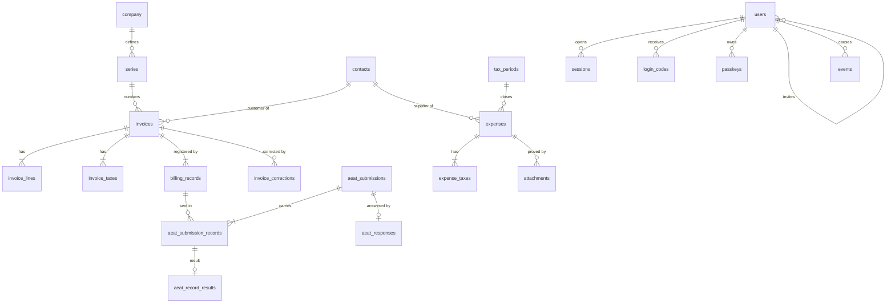

# Interface and entities

Agreed with the author on 2026-11-11. The visual proposal, with phone mock-ups of every screen, was reviewed outside the repository; this file keeps what was decided.

## Navigation

Mobile first, with five entries in a bottom bar: Home, Invoices, Expenses, Contacts and More (taxes and settings).

## Screens

| # | Screen | Purpose | Entities |
|---|---|---|---|
| 1 | Home | Summary of the quarter (output VAT, input VAT, invoiced, result of form 303) and everything that needs attention: pending or rejected submissions, chain verification, last backup. | `invoices`, `expenses`, `aeat_*` |
| 2 | Invoices | List with the AEAT state of each invoice and filters by year, series and state. | `invoices`, `billing_records`, `aeat_*`, `series` |
| 3 | New invoice | The customer is picked from Contacts, or created on the spot, and copied into the invoice when it is issued. Review step before issuing. | `invoices`, `invoice_lines`, `contacts`, `series` |
| 4 | Invoice detail | Submission history, PDF with the QR code, and the corrections Veri*factu allows: correcting a record ("subsanación"), a corrective invoice ("rectificativa") and cancellation. | `billing_records`, `aeat_*`, `invoice_corrections`, `company` |
| 5 | Contacts | Customers and suppliers in one list, with their tax data and what was invoiced to or spent with each. | `contacts` |
| 6 | Expenses | Received invoices and receipts, with the supporting document attached, category, bases and VAT per rate and deductible percentage. | `expenses`, `expense_taxes`, `attachments`, `contacts` |
| 7 | Taxes | VAT books per quarter, exportable for the accounting firm; indicative result of form 303; closing a quarter. | `invoice_taxes`, `expense_taxes`, `tax_periods` |
| 8 | Settings | Company data printed on invoices, series, AEAT environment and certificate status, the user's passkeys, users and invitations, open sessions. The certificate is configured on the server, not uploaded. | `company`, `series`, `passkeys`, `users`, `sessions` |
| 9 | Sign-in | No passwords: a one-time code sent by email, or a passkey. Signing up is the first sign-in of an invited address. Revocable sessions. | `users`, `login_codes`, `passkeys`, `sessions`, `events` |

## Entities

| Table | Content | Changes | Status |
|---|---|---|---|
| `invoices`, `invoice_lines`, `invoice_taxes` | Issued invoices with issuer and customer data and addresses copied at issue time. | Insert-only | Exists |
| `billing_records` | Veri*factu registration and cancellation records with their chained hash, including the records that replace rejected ones. | Insert-only | Exists |
| `aeat_submissions`, `aeat_submission_records` | Each request sent to the AEAT and the records it carried. | Insert-only | Exists |
| `aeat_responses`, `aeat_record_results` | What came back for each request and for each record. The state of an invoice is derived from here. | Insert-only | Exists |
| `events` | Event log: sign-ins, issued and cancelled invoices, submissions. | Insert-only | Exists |
| `users`, `sessions` | Users, identified by email address and invited by another user, and their sessions. No passwords. | Editable | Exists |
| `login_codes` | One-time sign-in codes sent by email, stored hashed, with their guesses. | Editable (guesses, use) | Exists |
| `passkeys`, `webauthn_ceremonies` | Users' passkeys (public key and counter), and the pending challenge of each registration or sign-in. | Editable, deletable | Exists |
| `invoice_corrections` | Which invoice corrects which, and how (by substitution or by differences). | Insert-only | To do |
| `company` | Name, NIF and address of the issuer. Replaces the current environment variables. | Editable | Exists |
| `series` | Numbering series, their kind (regular or corrective) and whether they are active. | Editable, never deleted | Exists |
| `contacts` | Customers and suppliers: name, NIF, address, email and role. | Editable | Exists |
| `expenses`, `expense_taxes` | Received invoices and receipts. | Editable until the quarter is closed | To do |
| `attachments` | Supporting documents of expenses. | Insert-only | To do |
| `tax_periods` | Quarters and whether they are closed. | Can only be closed | To do |

## Decisions

The author accepted the recommended option for each open question:

1. Customers and suppliers share one `contacts` table.
2. Expenses can be edited until their quarter is closed; every change goes to the event log.
3. Supporting documents are stored inside Postgres while the volume is small.
4. Several users from the start, without roles for now.
5. The interface is in Spanish; code stays in English and the texts live in one translations file.
6. Correcting a record ("subsanación") comes before 1 January 2027; corrective invoices come after.
7. No passwords: sign-up and sign-in with a code sent by email, plus passkeys to make it easier (decided by the author later on 2026-11-11; it replaces the password and second factor planned for screen 9).

## Order

1. Before 1 January 2027: sign-in, settings (company and series), contacts (customers only), invoices with submission state, PDF with QR and record correction, home with the warnings.
2. First quarter of 2027: expenses with supporting documents, suppliers, taxes (VAT books and export), closing a quarter.
3. Later: corrective invoices, exempt operations and foreign customers, Android app, catalogue of usual items.
